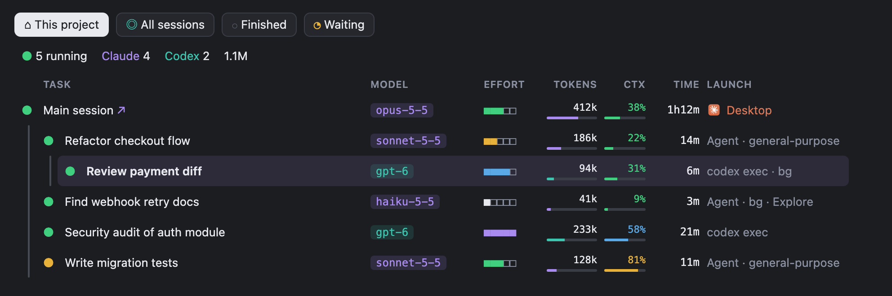

# Agent Radar

**English** · [Русский](README.ru.md)

A live pane for [Claude Code](https://code.claude.com) that shows every agent working for you: Claude subagents and the Codex runs they launch, nested under whoever started them, with model, effort, tokens, context fill, elapsed time and launch method.



> [!NOTE]
> Agent Radar is a Claude Code **mod** — a plugin built on Claude Code's function-hooks technology (`hooks/register.tsx`, drawn through `ui.render` into a Pane). It is built and tested on **macOS**. **Linux and Windows** are supported but not yet tested on real machines: the pane and both scopes work the same; *CLI* copies the resume command instead of opening Terminal, and on Linux there is no Claude Desktop, so *open chat* and *handoff* are absent.

> Screenshots show fictional projects and numbers.

## Features

- **Two scopes.** *This session* shows the current session, its subagents, the Desktop sessions it started and the Codex runs they launched; rows quiet for 15 minutes wait for *Finished*, as in *All*. *All* scans every Claude Code and Codex session active in the last 15 minutes (2 hours with *Finished* on), grouped by project; each project header carries a small pill per family with a square per agent, running ones in the family's color.
- **Background commands.** Under *This session*, a section lists the commands this session and its subagents run in the background: builds, watchers, waits, `Monitor` watches, and agent launches (`codex exec`, `claude -p`) under their family's mark. *Active* (the default) shows the running ones, *All* every one. A command opens its own details: status, start, how long it ran, the full command line, *Stop* and *Command*. It ends when the session is told its task ended; a watch, at its deadline.
- **One row per agent:** status dot, task title, model, effort (five squares: low · medium · high · xhigh · max), tokens in + out with a bar scaled to the busiest agent, context window fill (green < 50%, blue < 75%, yellow < 90%, red), elapsed time, how it was launched: the Claude or Codex mark and the method (Desktop, CLI, Agent SDK, `exec`, background or not).
- **Nesting.** A Codex run launched from a subagent's Bash call appears under that subagent; Codex subagents appear under their parent thread. A session with agents under it folds to one row with their count.
- **Details** open under the clicked row's tree: token breakdown (new input, cache read/write, output, reasoning), context and Codex rate-limit meters, an activity sparkline, the tools used, the exact launch command.
- **Actions**: open the chat in Claude Desktop, compact, hand off to a new session, stop (with confirmation), ask for status, message a subagent, restart, resume in Terminal (`claude --resume` / `codex resume`), reveal folder or journal, copy command or ID, pin, hide.
- **Compact layout** for narrow panes: two lines per agent, columns still aligned.
- **English and Russian** interface.

**Details** of the selected row:


**All**: every session, grouped by project:


**Compact** layout in a narrow pane:


## Requirements

- macOS, Linux or Windows
- Claude Code with mods support (function-hooks plugins), in the terminal or in the Claude desktop app
- Python 3 (`python3`; `python` on Windows) — used to scan session journals
- Optional: [Codex CLI](https://github.com/openai/codex) or Codex Desktop, Claude Desktop — their sessions show up when present

## Install

At the Claude Code prompt:

```
/plugin install agent-radar --marketplace cioxideru/agent-radar
```

Answer `y` to add the marketplace and pick the *user* scope so the pane opens in every session. From a shell:

```bash
claude plugin marketplace add cioxideru/agent-radar
```

```bash
claude plugin install agent-radar@agent-radar --scope user
```

The pane opens by itself when a session starts, and opening or closing it by hand in one chat does the same in the others within a few seconds. After you close it, new sessions start without it until `/agent-radar` opens it again.

### Update and remove

```bash
claude plugin marketplace update agent-radar
```

```bash
claude plugin update agent-radar@agent-radar
```

```bash
claude plugin uninstall agent-radar@agent-radar
```

Inside a running session, `/reload-plugins` picks up a new version without a restart.

### From a clone

To try a local copy without installing it, start Claude Code with the folder as a plugin directory:

```bash
git clone https://github.com/cioxideru/agent-radar.git
```

```bash
claude --plugin-dir ./agent-radar
```

## Settings

| Option | Values | Default |
|---|---|---|
| `language` | `en`, `ru` | `en` |

Change it in `/config` (row *agent-radar.language*) or in `settings.json`:

```json
{ "pluginConfigs": { "agent-radar": { "options": { "language": "ru" } } } }
```

## How it works

There is no server and no network access. The mod runs inside Claude Code and reads what is already on disk:

| Source | What it gives |
|---|---|
| Claude Code hooks (`agent.spawn`, `turn.step`, `tool.call`) | this session's subagents, their tokens and the `codex exec` commands they run |
| `~/.claude/projects/**/*.jsonl` | other Claude Code sessions and subagents |
| `~/.codex/sessions/YYYY/MM/DD/rollout-*.jsonl`, `~/.codex/session_index.jsonl` | Codex runs: model, effort, tokens, context, rate limits, titles |
| `~/Library/Application Support/Claude/claude-code-sessions` (`%APPDATA%\Claude` on Windows) | which sessions belong to Claude Desktop, for the *open chat* link |

A small Python scanner (`scan.py`, embedded in `hooks/scan.ts`) reads the journals every 3 s for this session and every 10 s for all sessions, only while the pane is open; chats share one *All* scan through the mod's store instead of each reading the same journals.

## Development

See [AGENTS.md](AGENTS.md) for the layout, checks and conventions.

```bash
claude --plugin-dir ~/path/to/agent-radar
```

## License

[Apache-2.0](LICENSE). Not affiliated with Anthropic or OpenAI; Claude and Codex are trademarks of their owners.
