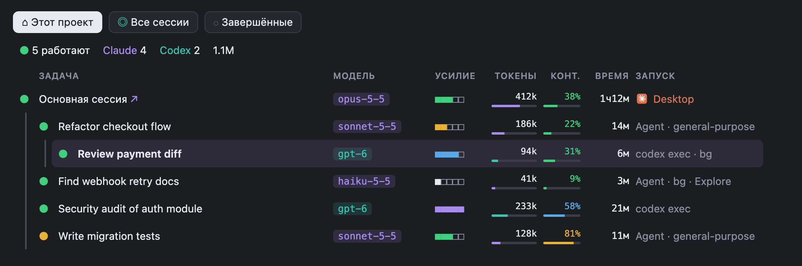
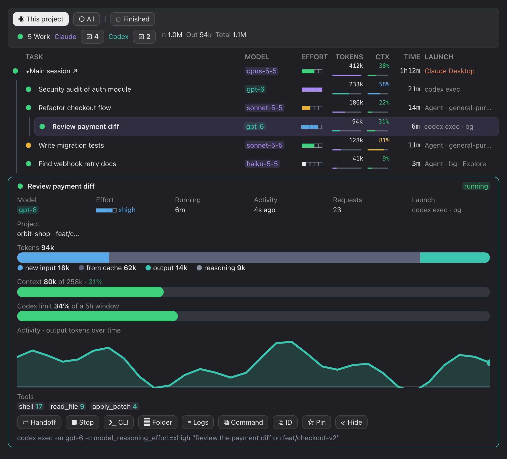
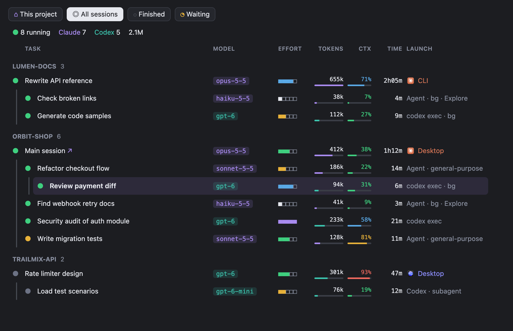
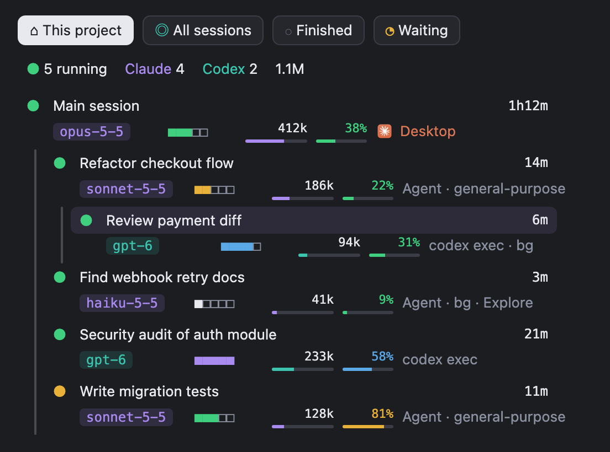

# Agent Radar

[English](README.md) · **Русский**

Живая панель для [Claude Code](https://code.claude.com), которая показывает всех агентов, работающих на вас: субагентов Claude и запущенные ими прогоны Codex. Каждый агент вложен под того, кто его запустил, рядом модель, усилие, токены, заполнение контекста, время работы и способ запуска.



> [!NOTE]
> Agent Radar — это **мод** Claude Code, то есть плагин на технологии function-hooks (`hooks/register.tsx`, рисуется через `ui.render` в панель Pane). Он сделан и проверен на **macOS**. **Linux и Windows** поддерживаются, но на настоящих машинах ещё не проверялись: панель и оба охвата работают так же; кнопка *CLI* копирует команду возобновления вместо открытия Terminal, а на Linux нет Claude Desktop, поэтому нет кнопок *открыть чат* и *передать*.

> На скриншотах вымышленные проекты и цифры.

## Возможности

- **Два охвата.** «Этот проект» — текущая сессия, её субагенты и запущенные ими Codex. «Все» — все сессии Claude Code и Codex, активные за последние 15 минут (2 часа с включёнными «Завершёнными»), сгруппированные по проектам.
- **Строка на агента:** точка статуса, задача, модель, усилие (пять квадратов: low · medium · high · xhigh · max), токены вход + выход с полосой относительно самого активного агента, заполнение контекста (зелёный < 50%, синий < 75%, жёлтый < 90%, красный), время, способ запуска (Claude Desktop, Claude Code CLI, Agent SDK, `codex exec`, Codex Desktop, в фоне или нет).
- **Вложенность.** Codex, запущенный из Bash субагента, виден под этим субагентом; субагенты Codex — под родительским потоком.
- **Подробности** открываются под деревом выбранной строки: разбивка токенов, шкалы контекста и лимита Codex, график активности, инструменты, точная команда запуска.
- **Действия:** открыть чат в Claude Desktop, сжать контекст, передать работу в новую сессию, остановить (с подтверждением), спросить статус, написать субагенту, перезапустить, открыть сессию в Terminal (`claude --resume` / `codex resume`), показать папку или журнал, скопировать команду или ID, закрепить, скрыть.
- **Компактный вид** для узкой панели: две строки на агента, колонки выровнены.
- **Интерфейс на английском и русском.**

**Подробности** выбранной строки:



**Все**: все сессии по проектам:



**Компактный вид** в узкой панели:



## Требования

- macOS, Linux или Windows
- Claude Code с поддержкой модов (function-hooks плагинов) — в терминале или в приложении Claude
- Python 3 (`python3`; на Windows `python`) — сканирует журналы сессий
- По желанию: [Codex CLI](https://github.com/openai/codex) или Codex Desktop, Claude Desktop — их сессии появятся, если они установлены

## Установка

В строке ввода Claude Code:

```
/plugin install agent-radar --marketplace cioxideru/agent-radar
```

Ответьте `y` на добавление маркетплейса и выберите область *user*, чтобы панель открывалась во всех сессиях. Из терминала:

```bash
claude plugin marketplace add cioxideru/agent-radar
```

```bash
claude plugin install agent-radar@agent-radar --scope user
```

Панель открывается сама при старте сессии. Если открыть или закрыть её вручную в одном чате, в остальных она откроется или закроется через несколько секунд. После закрытия новые сессии начинаются без неё, пока `/agent-radar` не откроет её снова.

### Обновление и удаление

```bash
claude plugin marketplace update agent-radar
```

```bash
claude plugin update agent-radar@agent-radar
```

```bash
claude plugin uninstall agent-radar@agent-radar
```

В открытой сессии `/reload-plugins` подхватывает новую версию без перезапуска.

### Из клона

Чтобы попробовать локальную копию без установки, запустите Claude Code с папкой как каталогом плагина:

```bash
git clone https://github.com/cioxideru/agent-radar.git
```

```bash
claude --plugin-dir ./agent-radar
```

## Настройки

| Параметр | Значения | По умолчанию |
|---|---|---|
| `language` | `en`, `ru` | `en` |

Русский язык включается в `/config` (строка *agent-radar.language*) или в `settings.json`:

```json
{ "pluginConfigs": { "agent-radar": { "options": { "language": "ru" } } } }
```

## Как это устроено

Отдельного сервера и сетевых запросов нет. Мод работает внутри Claude Code и читает то, что уже лежит на диске: события хуков текущей сессии, журналы `~/.claude/projects`, журналы Codex в `~/.codex/sessions` и записи Claude Desktop о сессиях. Небольшой сканер на Python (`scan.py`, встроен в `hooks/scan.ts`) перечитывает журналы раз в 3 секунды для проекта и раз в 10 секунд для всех сессий.

## Разработка

Структура, проверки и соглашения — в [AGENTS.md](AGENTS.md).

## Лицензия

[Apache-2.0](LICENSE). Проект не связан с Anthropic и OpenAI; Claude и Codex — товарные знаки их владельцев.
